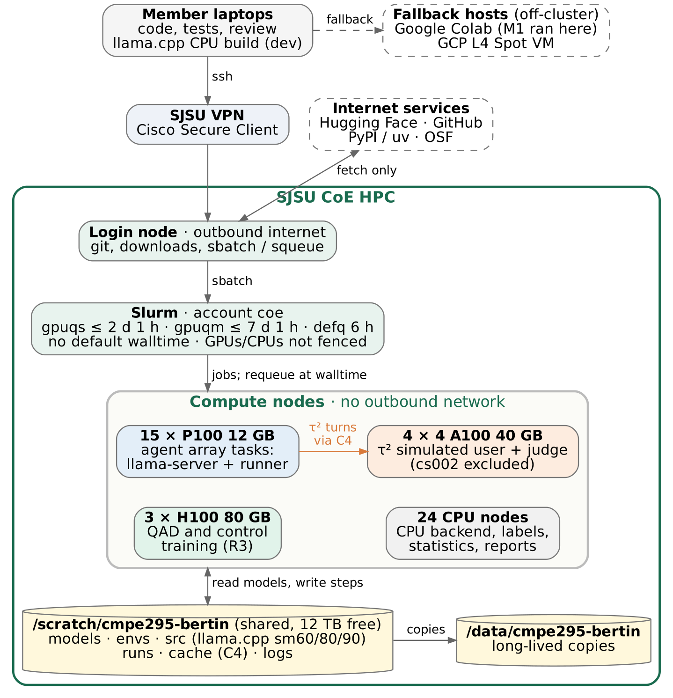

## Introduction

The testbed is an experiment pipeline built around a pluggable inference core. Its job is to run thousands of agent episodes under conditions that differ in exactly one factor (the model file, the backend or the repair), record every step, and turn the records into the pre-registered statistics. The agent itself is a single tool-calling model in a ReAct-style loop: at each step it reads the conversation and the tool schemas and either calls tools or answers in text, and a called tool's result goes back into the conversation [@yao2023react]. Everything else in the loop (the tool executors, the scripted or simulated user, and the official checkers) is environment and is identical for every configuration.

The architecture is presented in two views. Figure 1 is the software architecture: eleven components, C1 to C11, grouped by layer, with their function, technology and data flow. Figure 2 is the infrastructure: where each part runs on the SJSU College of Engineering HPC cluster and how jobs and data move between the login node, the GPU and CPU compute nodes and the shared storage. Every reported number comes from a cluster node named in its run manifest; the same code also runs on a laptop with llama.cpp's CPU backend for development.

The architecture combines three styles, each chosen for a need of a controlled measurement study:

- **Batch-sequential pipeline (pipe and filter).** Configurations become episodes, episodes become step logs, logs become failure labels, and labels become statistics. Each stage persists its output before the next reads it, so any stage can rerun alone: revising the failure codebook relabels frozen logs without rerunning a model.
- **Layered plugin architecture.** The Episode Runner (C2) depends only on the benchmark (C1), backend (C3) and repair (C7) interfaces. Implementations are registered by name, so changing one experimental factor changes one configuration field, which is what a paired comparison needs.
- **Client-server at the inference boundary, plus a job layer.** Each model runs in its own llama-server process that C2 calls over HTTP on the node's loopback interface. This separates the model's memory and energy from the harness's, and a server crash cannot corrupt the logs. The Experiment Config and Registry (C11) turns run specifications into Slurm array jobs, and the registry, not Slurm, decides what still needs to run.

One agent step proceeds as follows. C11 expands a configuration into run specifications and submits them as Slurm jobs. On a compute node, C2 starts an episode with a fixed seed, and C1 supplies the task, its tool schemas and a tool environment. C2 renders the conversation with the model's own chat template, and the repair hook (C7) may attach a grammar or select a model copy. C3 sends the rendered prompt to llama-server on the CUDA or CPU backend and returns text, timings and token counts, while the Cost Profiler (C9) samples power and memory. C2 parses any tool call; the environment executes it, or, if the model answered in text, the next user turn comes from the task script (BFCL) or the simulated user (τ²). The Step Logger (C5) appends the step record, and at the end of the episode C1's official checker records the verdict. After a run, C5 writes Parquet, the Failure Classifier (C6) labels every step, and Analysis and Statistics (C10) runs the registered tests.

## Architecture Subsystems

Table 3 summarizes the components, their technology and their owners. The paragraphs that follow describe each component's purpose, inputs and outputs, the key design choice and how it is tested, grouped by layer.

Table: Table 3. Components of the testbed, their function and technology, data flow and owners.

| Component | Function | Technology | Inputs → outputs | Owner |
|---|---|---|---|---|
| C1 Benchmark Adapter | Load tasks, tools and environments; official scoring | Python; bfcl-eval, τ²-bench-verified | Benchmark repositories → tasks, environments, verdicts | Vritika |
| C2 Episode Runner | Drive model, tool and user turns | Python 3.12 | Run specifications, tasks → steps, episodes | Ekant |
| C3 Inference Backends | One generate call over the CUDA and CPU backends | llama-server (llama.cpp d812350), GGUF | Prompt, constraint → text, timings | Ekant |
| C4 Simulated-User Service and Cache | Serve and cache τ² user turns | llama-server on an A100, SQLite, SHA-256, LiteLLM | Conversation prefix → user turn | Vritika |
| C5 Step Logger | One record per step | JSONL, Parquet (pyarrow) | Step events → step table | Ekant |
| C6 Failure Classifier | One failure class per step | Python rules, JSON Schema | Steps → labels | Vritika |
| C7 Repair Modules | R1 grammar, R2 added bits, R3 QAD variants | GBNF, llama-quantize, second server | Request, context → constraint or model copy | Ekant (R1); Yashashav (R2, R3) |
| C8 QAD Training Pipeline | QAD, train-longer control, export | PyTorch, Hugging Face Transformers, Slurm | BF16 weights, data → GGUF files | Yashashav |
| C9 Cost Profiler | Memory, latency, tokens, energy | NVML (pynvml), psutil, server timings | Markers, samples → cost table | Ekant |
| C10 Analysis and Statistics | Registered tests, damage map, repair matrix | pandas, NumPy, SciPy, R (lme4), matplotlib | Labels, costs → figures, tables | Vritika |
| C11 Experiment Config and Registry | Grids, run IDs, manifests, Slurm jobs | Hydra YAML, Git, sbatch | Configuration → run specifications, jobs, manifests | Yashashav |

### Workload: Benchmarks and the Simulated User

**C1 Benchmark Adapter.** C1 puts BFCL multi-turn [@mao2024bfcl] and τ²-bench-verified [@barres2026tau2; @cuadron2025saber] behind one task schema: the tools as JSON Schema, the initial environment state, the user turns or user instructions, and the official checker. Its inputs are the pinned benchmark repositories; its outputs are task objects, live tool environments for the runner, and episode verdicts. The key design choice is to score with the unmodified official checkers (bfcl-eval's multi-turn state and response checker and τ²'s database evaluator), so our numbers are comparable with the benchmarks' own. C1 also fixes the task set: a seeded sample of 100 tasks from each of the three BFCL categories and the 201 τ² tasks whose gold actions write to the database, 501 tasks in all. It is tested by evaluator agreement (FR-E2): re-scoring the BF16 reference episodes with our pipeline agrees with the official checker on every episode for all six models, after models without a bfcl-eval handler were aligned with the runner's handling of malformed call blocks.

**C4 Simulated-User Service and Cache.** τ²-bench needs a language model to play the customer. C4 serves this simulated user (gpt-oss-20b, temperature 0) from one llama-server job on an A100 for a whole batch of experiments, announced to the agent jobs through an endpoint file on shared storage. Each agent job reaches it through a local cache that keys every request by a SHA-256 hash of the simulator file, sampling settings, seed and conversation prefix and stores the reply in SQLite, so that identical prefixes receive identical user turns in every condition and replays need no simulator. The key design choices are self-hosting (no API bill, a versioned user model) and running the service inside the cluster, because compute nodes cannot reach an outside VM. Testing showed the service to be the least reliable part of the system: llama-server segfaults under load and on specific requests, so the job restarts a crashed server on a new port and agent jobs reconnect and requeue the interrupted episode, and simulator outages never count as attempts against the episode. BFCL scripts its user turns and never calls C4.

### Execution: Runner, Backends and Repairs

**C2 Episode Runner.** C2 drives the agent loop: generate, parse, execute, observe. Its inputs are a run specification (model file, backend, repair, task, seed and decoding settings) and a task from C1; its outputs are step events for C5 and an episode record. It renders the prompt with each model's own chat template (bfcl-eval's handler for Qwen3; the published templates for SmolLM3 and LFM2.5), uses non-thinking mode where the template offers one, allows a 40,960-token context with at most 4,096 new tokens per step, and enforces BFCL's limit of 20 steps per turn. The key design choice is resumability: an episode's run ID is a hash of its specification, finished episodes are never rerun, and infrastructure failures are retried with the same seed up to four attempts before the episode is excluded and listed. C2 is tested by unit and property tests and by a resume test on the cluster (104 of 104 episodes completed across forced walltime kills with no duplicates).

**C3 Inference Backends.** C3 exposes one call, generate(messages, tools, constraint), over llama-server built for the CUDA and CPU backends from the same pinned commit. It sends the rendered prompt to the raw completion endpoint with one slot and prompt caching off, so both backends receive identical prompt tokens and no baseline request picks up the tool-call grammar the server's chat endpoint attaches when tools are passed. Its outputs are the generated text, stop reason, time to first token and token counts. The key design choice is the second code path: the CPU backend runs the same GGUF file with different kernels, which isolates kernel effects from format effects and is the path users without a GPU run. It is tested by backend parity (FR-E17): 200 fixed prompts per model replayed greedily on both backends receive identical prompt tokens in every case, while the outputs differ on 4% to 9.5% of prompts at BF16 and 33% to 47% at Q4_0 for the Qwen3 models, which is why the backend is a factor in every comparison.

**C7 Repair Modules.** C7 plugs into C3 through a pre-request hook, so a repaired condition differs from its baseline only in the repair. R1, grammar-constrained decoding (owner Ekant), builds a GBNF grammar from the task's tool schemas in the model's native call syntax: JSON blocks for Qwen3 and SmolLM3 and Pythonic call lists for LFM2.5. The "free" grammar used as the R1 arm admits either schema-valid calls (known tool names, required arguments, no extra keys, correct types) or plain text; a "forced" calls-only grammar is a labelled ablation. The grammars are checked by property tests against llama.cpp's own grammar validator at the pinned commit: every schema-valid call is accepted and unknown names, missing required keys and extra keys are rejected. R2, added bits (owner Yashashav), supplies higher-precision files: uniform Q5_0, Q6_K and Q8_0 (R2a); a layer-selective file at a matched 5.5 bits per weight whose upgraded tensors are ranked by KL divergence on held-out agent conversations (R2b); and a step-selective variant that keeps a Q4_0 and a Q8_0 server and chooses one per step (R2c), with the second copy's memory charged to the repair. R3 checkpoints from C8 arrive as ordinary model variants.

**C8 QAD Training Pipeline.** C8 (owner Yashashav) retrains models for R3. It runs PyTorch and Hugging Face Transformers as Slurm jobs on an H100 or A100 node, checkpointing at least every 30 minutes so a job can resume after its walltime. It trains the QAD arm, a student whose forward pass uses fake-quantized Q4_0 weights trained on the KL divergence to the BF16 teacher [@xin2026qad], and the train-longer control, the same model trained at full precision on identical data, order and steps and quantized afterwards. Its inputs are BF16 checkpoints and a fixed training mix with a manifest; its outputs are GGUF files written by an exporter that emits the trained Q4_0 codes and scales, verified by KL divergence on both backends before any agent run. The control is the key design choice: it separates quantization-aware retraining from simply training longer, the comparison published QAD results lack. Vendor QAD checkpoints such as Liquid AI's LFM2.5 Q4_0 files [@liquid2026qad] enter the grid the same way.

### Measurement: Step Records, Failure Labels and Costs

**C5 Step Logger.** C5 writes one JSONL record per agent step during a run: the prompt and token hashes, the raw output, the parsed calls, the execution results, the stop reason and the timings. Episode records are written atomically when an episode finishes, so a crash leaves no partial step file. After a run C5 writes typed Parquet tables for analysis and release. The key design choice is to keep everything the classifier and the statistics need, so that any later analysis, including a revised codebook, a shrinking error budget or pass^k, can be recomputed from frozen logs without rerunning a model. It is tested by round-trip tests and by checking that every finished episode in a run has exactly one step file.

**C6 Failure Classifier.** C6 assigns every step one class from codebook v0, using the first matching rule: truncated output, a malformed call, the step limit, an unknown tool, invalid arguments against the JSON Schema, an execution error or an error returned in the tool payload, a missing call or a direct answer where a call was needed, and the non-failure classes (a valid call, a reply to the user, a correct abstention, the end of a turn). Its inputs are step records and the task's tool schemas; its outputs are labels joined to the step table. The key design choice is to label offline rather than during the run, because some classes need the whole turn or episode and the codebook can change without rerunning models. Codebook v0 is implemented with unit tests for every rule; a second annotator study to measure agreement and produce codebook v1 is planned.

**C9 Cost Profiler.** C9 measures what each configuration and repair costs to deploy (RQ4). It reads llama-server's timings for time to first token and decode speed, samples GPU power, clocks and memory through NVML every 200 ms, samples host memory with psutil, and counts extra tokens such as the re-prefill a step-selective switch causes. The key design choice is to run cost measurements separately from the correctness runs, as single-stream blocks on an exclusively allocated node with warm-up and randomized interleaving, because shared nodes and concurrent jobs would make latency and energy figures meaningless.

**C10 Analysis and Statistics.** C10 turns labels and costs into the pre-registered results: the damage map, the repair comparison matrix and the paper figures. It compares every 4-bit configuration with its BF16 reference on the same (task, seed) pairs, computes amplification ratios and differences in failures per 100 steps with 95% intervals from a paired cluster bootstrap over tasks (10,000 resamples), runs paired permutation tests and, as a registered secondary analysis, mixed-effects models in R with lme4. Every mean is shown with ±1 standard deviation over the four sampled seeds, and greedy results with Wilson intervals. It is tested with planted effects: synthetic data with known effects is analysed by the same code, and every planted term was recovered while none was flagged on null data. The first damage map over all six models was produced by this component.

### Control: Configuration, Registry and Jobs

**C11 Experiment Config and Registry.** C11 (owner Yashashav) declares experiment grids as Hydra YAML files and expands each into run specifications. Every episode's run ID is a hash of its specification, and every experiment directory is keyed by the hash of its specifications, so rerunning a finished run is a no-op and every result row resolves to a manifest that records the commit, model file SHA-256, llama.cpp build and backend, GPU, driver and node. C11 groups pending runs into Slurm array jobs sized under the partition walltime; array tasks catch the warning signal Slurm sends before the limit, requeue themselves and resume from the registry, so a walltime kill costs at most the episode in flight. Helper scripts submit a batch's simulated user, agent arrays, reports and a final stop job in one step and attach further experiments to a running simulator.

### Cluster Facts That Shaped the Design

Moving all measurement onto the CoE HPC cluster changed the architecture in concrete ways. Compute nodes have no outbound network, so every setup step is split into a fetch phase on the login node and a build or run phase in a job, and every model file, environment and llama.cpp build is staged in the shared group folder, where every log, step record and cache entry is also written. Because a job cannot reach an outside virtual machine, the simulated user moved from a cloud VM into the cluster as an A100 job. Partitions enforce walltimes (two days on the GPU partitions, six hours on the default CPU partition), which led to the requeue-and-resume design of C2 and C11 and to 30-minute checkpoints in C8. The quality-of-service policy allows at most two GPU nodes per user at a time, so the agent arrays share nodes and the simulated user takes one GPU of an A100 node. Nodes are of mixed GPU generations (P100, A100 and H100) and drivers, so the node, GPU and driver are recorded in every manifest, and faulty GPUs (one A100 node's GPU 0 is still excluded) are kept out with node exclusions and a smoke test before each batch. Finally, the group folder is shared by three members, so every job sets a group-writable file mode; files written by a script that did not caused permission failures in shared caches during the main runs and were replaced with group-writable copies.
