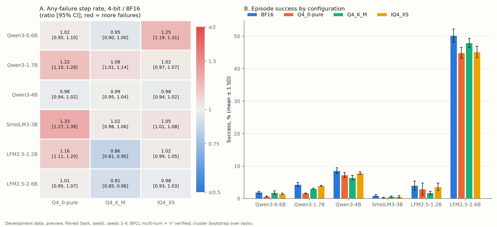

# Damage map v1: 4-bit damage across six models (development data, preview)

**Development data, preview.** Not confirmatory: the pre-registration is not filed. H1 grid complete (18/18 cells, `results/m3/run_status.json`); exclusions follow the registered rule and decisions 15, 16 and 18. Method: paired (task, seed), seeds 1-4, cluster bootstrap over tasks (10,000 resamples), ratio of pooled per-step failure rates, classifier codebook v0; success is mean ± 1 SD over the 4 seeds. Per-model detail: `docs/damage_previews/`.

## Any-failure amplification (4-bit / BF16 step failure rate)

| Model | Format | Pairs | BF16 per 100 steps | 4-bit per 100 steps | Ratio [95% CI] | Difference per 100 [95% CI] | Classes with CI excluding 1 (↑ more / ↓ fewer than BF16, largest first) |
|---|---|---|---|---|---|---|---|
| Qwen3-0.6B | Q4_0-pure | 1999 | 30.47 | 31.13 | 1.02 [0.95, 1.10] | 0.66 [-1.65, 3.01] | `missing_call_direct_answer` ↑, `exec_error` ↓, `tool_error_payload` ↓ |
| Qwen3-0.6B | Q4_K_M | 2000 | 30.44 | 28.96 | 0.95 [0.90, 1.00] | -1.48 [-2.98, 0.03] | `exec_error` ↓, `missing_call_direct_answer` ↑, `tool_error_payload` ↓ |
| Qwen3-0.6B | IQ4_XS | 1995 | 30.45 | 38.16 | 1.25 [1.19, 1.31] | 7.71 [5.99, 9.40] | `invalid_args` ↑, `exec_error` ↑, `unknown_tool` ↑ |
| Qwen3-1.7B | Q4_0-pure | 1904 | 26.52 | 32.29 | 1.22 [1.15, 1.28] | 5.77 [4.17, 7.35] | `exec_error` ↑, `missing_call_direct_answer` ↑, `invalid_args` ↑ |
| Qwen3-1.7B | Q4_K_M | 1994 | 26.92 | 28.96 | 1.08 [1.01, 1.14] | 2.04 [0.29, 3.78] | `unknown_tool` ↓, `invalid_args` ↑, `malformed` ↑ |
| Qwen3-1.7B | IQ4_XS | 1979 | 26.99 | 27.63 | 1.02 [0.97, 1.07] | 0.64 [-0.72, 1.96] | `unknown_tool` ↑, `exec_error` ↓, `missing_call_direct_answer` ↑ |
| Qwen3-4B | Q4_0-pure | 2002 | 23.05 | 22.55 | 0.98 [0.94, 1.02] | -0.50 [-1.45, 0.47] | `unknown_tool` ↓, `tool_error_payload` ↑, `exec_error` ↓ |
| Qwen3-4B | Q4_K_M | 2001 | 23.05 | 22.85 | 0.99 [0.95, 1.04] | -0.21 [-1.24, 0.83] | `missing_call` ↑, `unknown_tool` ↓, `exec_error` ↓ |
| Qwen3-4B | IQ4_XS | 1999 | 23.07 | 22.65 | 0.98 [0.94, 1.02] | -0.42 [-1.32, 0.50] | `tool_error_payload` ↑, `exec_error` ↓ |
| SmolLM3-3B | Q4_0-pure | 1934 | 33.32 | 44.26 | 1.33 [1.27, 1.39] | 10.94 [9.20, 12.76] | `truncated` ↑, `missing_call_direct_answer` ↑, `tool_error_payload` ↓ |
| SmolLM3-3B | Q4_K_M | 1940 | 33.18 | 33.86 | 1.02 [0.98, 1.06] | 0.68 [-0.63, 1.96] | `truncated` ↑, `malformed` ↑ |
| SmolLM3-3B | IQ4_XS | 1932 | 33.39 | 34.94 | 1.05 [1.01, 1.08] | 1.56 [0.36, 2.79] | `missing_call_direct_answer` ↑, `tool_error_payload` ↓, `truncated` ↑ |
| LFM2.5-1.2B | Q4_0-pure | 1993 | 29.81 | 34.43 | 1.16 [1.11, 1.20] | 4.62 [3.45, 5.81] | `invalid_args` ↑, `unknown_tool` ↑, `exec_error` ↓ |
| LFM2.5-1.2B | Q4_K_M | 1993 | 29.79 | 25.47 | 0.86 [0.81, 0.90] | -4.32 [-5.77, -2.86] | `exec_error` ↓, `unknown_tool` ↓, `missing_call` ↑ |
| LFM2.5-1.2B | IQ4_XS | 1989 | 29.83 | 30.45 | 1.02 [0.99, 1.05] | 0.63 [-0.24, 1.51] | `invalid_args` ↑, `tool_error_payload` ↓, `malformed` ↑ |
| LFM2.5-2.6B | Q4_0-pure | 2000 | 10.95 | 11.03 | 1.01 [0.95, 1.07] | 0.08 [-0.62, 0.80] | `unknown_tool` ↓, `tool_error_payload` ↑, `invalid_args` ↑ |
| LFM2.5-2.6B | Q4_K_M | 2002 | 10.98 | 9.96 | 0.91 [0.85, 0.96] | -1.02 [-1.68, -0.38] | `unknown_tool` ↓, `exec_error` ↓, `truncated` ↓ |
| LFM2.5-2.6B | IQ4_XS | 2003 | 10.98 | 10.73 | 0.98 [0.93, 1.03] | -0.25 [-0.83, 0.31] | `truncated` ↓, `missing_call` ↑, `invalid_args` ↑ |

## Episode success, % (mean ± 1 SD over seeds 1-4)

| Model | BF16 | Q4_0-pure | Q4_K_M | IQ4_XS |
|---|---|---|---|---|
| Qwen3-0.6B | 2.0 ± 0.3 | 0.7 ± 0.1 | 1.9 ± 0.5 | 1.5 ± 0.2 |
| Qwen3-1.7B | 4.4 ± 0.6 | 1.6 ± 0.1 | 3.1 ± 0.2 | 4.0 ± 0.2 |
| Qwen3-4B | 8.6 ± 0.9 | 7.3 ± 0.8 | 6.5 ± 0.7 | 7.9 ± 0.4 |
| SmolLM3-3B | 1.0 ± 0.3 | 0.3 ± 0.1 | 0.6 ± 0.2 | 0.6 ± 0.3 |
| LFM2.5-1.2B | 4.0 ± 1.4 | 3.0 ± 1.8 | 1.8 ± 0.5 | 3.6 ± 1.1 |
| LFM2.5-2.6B | 50.2 ± 2.0 | 44.9 ± 1.7 | 48.0 ± 1.4 | 45.2 ± 1.8 |
